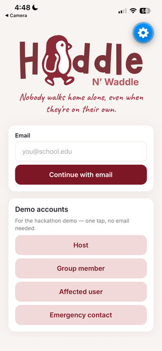
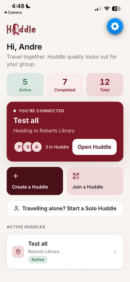
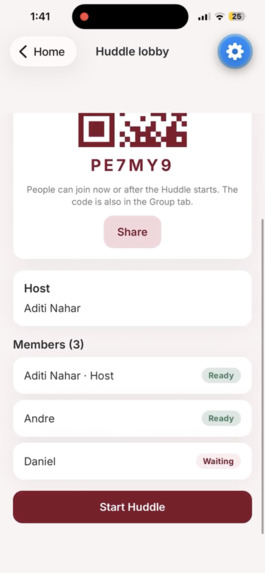
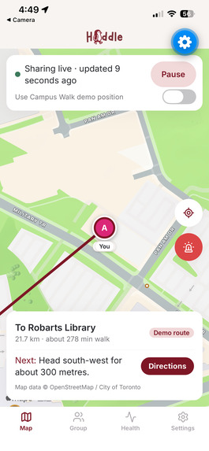
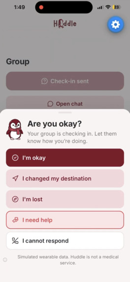
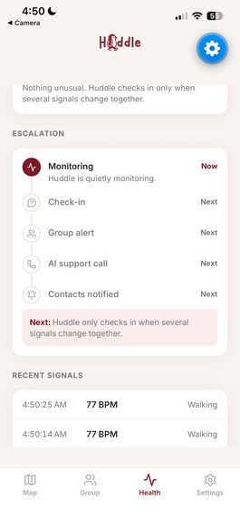

<p align="center">
  
</p>

<p align="center">
  A native app for groups and solo travellers who want someone watching out for them —
  without being watched over.
</p>

---

## What it is

Huddle is an Expo app for students, tourists, and friends travelling together — and for
anyone travelling alone. A group creates or joins a private Huddle, shares live location
while it's active, and sets a destination. If someone may need support, Huddle doesn't
jump straight to an alarm — it checks in with them, then tells the group, then calls them,
and only after that reaches their trusted contacts.

You don't need a group to use it. A **Solo Huddle** is just you: pick a destination (or
don't) and start. Pulse and Lifeline run exactly the same — the only difference is that
the "tell the group" step has nobody to notify, so it falls straight through to the AI
phone call and then your trusted contacts. It's built for the person walking home alone
at night as much as for a group of friends out together.

Nothing is shared, recorded, or sent to a contact without that person's consent. Huddle
never diagnoses a medical event, never labels a place as safe or unsafe, and never claims
to be emergency services.

The product was built around three features, with everything else — onboarding, the map,
group chat — supporting them.

| | |
|---|---|
| **Lifeline** | An automatic AI phone call that talks an unresponsive member toward their destination, using real walking directions and nearby public places. |
| **Safety Circle** | A step-by-step escalation — check-in, group alert, AI call, trusted contacts — backed by server-side timers so it keeps running even if every phone is closed. |
| **Pulse** | A simulated wearable feed and a deterministic, explainable scoring system that decides when a check-in is warranted. It is not machine learning, and it says so on screen. |

The full behaviour of each — state machines, timers, what the AI is and isn't allowed to
know — is documented in [`CLAUDE.md`](CLAUDE.md) and [`docs/architecture.md`](docs/architecture.md).

## Why we built it

Every one of us has sent "home safe?" and then watched the screen, waiting. Most nights
the reply comes. Some nights it doesn't, and you're left with nothing between "they're
probably fine" and "call 911."

We kept coming back to one moment: **the person who needs help is the one least able to
ask for it.** They might be lost, or their drink was spiked, or they fell, or they're
panicking and can't think straight. Location sharing tells you *where* someone is. It
doesn't notice that something changed, and it doesn't *do* anything about it.

Huddle is the part in between. It notices, asks gently, tells the people who care, and
only reaches further when nobody can reach you. Nothing starts without the person's
consent, and every step says out loud why it's happening.

## How Huddle fits each challenge

### Project KAZE Challenge (Swapna Samuel)
*"How might we help people stay safe and get assistance when they are no longer in a
position to ask for help themselves?"*

This is the question Huddle was built around. Take Maya. She's at a bar with friends, and
someone spikes her drink. Twenty minutes later she's wandering away from the group,
confused, not looking at her phone. She will never press an SOS button.

She doesn't have to. Huddle closes **the gap between the moment someone can't protect
themselves and the moment someone else realizes it**:

1. **Help starts without her.** She drifts off her route, and her (simulated) wearable shows
   an unusual heart rate. Huddle asks once, quietly: *"Are you okay?"*
2. **Silence counts as a signal.** She doesn't answer within the buffer *she* chose at
   sign-up. Her friends get an in-app alert and a push: *"Maya may need support."*
3. **Nobody has to type.** If no friend responds, **Lifeline phones her** and talks her
   toward her destination: *"Head east for about 400 metres to Robarts Library."*
4. **Her trusted person is reached for her.** If she stays silent, the emergency contact
   *she picked* gets a real phone call and a text with her last-seen location, why Huddle
   was worried, and a recording of the call.

It works **when she can't call, can't text, and can't trigger an SOS.** The timers run on
the server, so escalation keeps going even if her phone dies.

- **Safety:** four layers (her, her group, an AI call, her trusted contact) so nobody
  depends on a single point of failure.
- **Dignity:** calm language at every step. Never "DANGER DETECTED," never alarm-red until
  it's truly escalated. Her friends see "may need support," not a diagnosis.
- **Privacy:** location, health signals, recording, and contact alerts are all **off by
  default.** Each contact only hears what Maya allowed (location? health summary?
  recording?). Phone numbers never leave her account.
- **Autonomy:** she chooses her contacts, her check-in buffer, and whether she gets an AI
  call or contact-only alerts. She can mark herself safe at any moment and stop everything.

We don't try to detect drugging or guess what happened. The challenge said it, and we
agree: **the goal is making sure help starts.**

### Hack the Valley × School of Cities
**Who is the user?** Students, newcomers, and young people getting around Toronto on foot
and by TTC, especially late at night, alone, or somewhere unfamiliar.

**What problem are they facing?** *"Where are safe routes to school, recreation, or
transit weakest?"* and *"Can you find a public washroom when you actually need one?"* The
city has already built the places that make a walk feel less alone: libraries, community
centres, schools, washrooms, transit stops. That information sits in open-data portals the
person on the sidewalk will never open.

**How do we solve it with the data we have?** Huddle puts Toronto's civic data right on
the map. When you're heading somewhere, it compares routes by how many public support
points are nearby, how close TTC access is, whether there's a transit disruption, and how
far you are from your group. Then it explains it in plain words: *"This route keeps you
closer to TTC access, a public library, and your group."* And when Lifeline calls someone
who's lost, it uses the same data to say where the nearest open public place is.

**How does it benefit the user?** You get a reason to pick one route over another, and a
specific place to go if something feels off. You don't have to read a single dataset.

**Responsible interpretation.** Huddle **never labels a street or neighbourhood "safe" or
"unsafe."** It describes *support context* (what's nearby), not risk. In the app it says
plainly: *"Historical safety data does not guarantee current safety and is used only as
contextual information."* There's an in-app **Data Sources** screen listing every dataset,
its publisher, refresh frequency, and limitations.

**AI with intention.** Gemini isn't a chatbot bolted on top. It turns live route data and
civic support points into one spoken, plain-language direction at the moment someone
needs it.

**Data sources** (City of Toronto Open Data unless noted):
- [Toronto Centreline (TCL)](https://open.toronto.ca/dataset/toronto-centreline-tcl/)
- [Pedestrian Network](https://open.toronto.ca/dataset/pedestrian-network/)
- [TTC Routes and Schedules (GTFS)](https://open.toronto.ca/dataset/ttc-routes-and-schedules/)
- [TTC GTFS-Realtime](https://open.toronto.ca/dataset/ttc-gtfs-realtime-gtfs-rt/) (a local mock feed is used for the demo disruption)
- [Library Branch General Information](https://open.toronto.ca/dataset/library-branch-general-information/) (Toronto Public Library)
- [Parks and Recreation Facilities](https://open.toronto.ca/dataset/parks-and-recreation-facilities/)
- [Washroom Facilities](https://open.toronto.ca/dataset/washroom-facilities/)
- [School Locations (all types)](https://open.toronto.ca/dataset/school-locations-all-types/)
- [Police Facility Locations](https://open.toronto.ca/dataset/police-facility-locations/)
- Hospitals and walking routes: [OpenStreetMap](https://www.openstreetmap.org/) contributors (ODbL), routed with [OSRM](https://project-osrm.org/)

### PointClickCare: Catch It Early
*"Small warning signs often show up before something serious happens."*

The same is true on a walk home. Before a fall or a crisis there's usually a run of small
changes: a heart rate climbing well past normal, running when you were walking, a sudden
stop, drifting 200 metres off the route. Any one of these is easy to miss. **Pulse catches
them while they're still small.**

- **The health risk:** falls and acute distress (a heart-rate spike, a sudden stop, a
  simulated fall) for someone who's out on their own.
- **The care team:** the person's own circle. That's the friends in their Huddle and the
  trusted contacts they picked, the people who'd step in first. It maps directly onto a
  care setting: a resident on an outing, and the staff who need to know *early* that
  something's off.
- **The AI:** a deterministic, rule-based risk engine on top of the person's own baseline,
  plus a health profile with an **NHANES-based** estimate for context. It's not a black
  box, and the app says so on screen.
- **It explains *why*, not just *that*.** This was the bonus, and it's the heart of Pulse.
  Every flag comes with human reasons: *"Heart rate is 93% above personal baseline."*
  *"Unexpected running detected."* Those same reasons appear on the group's alert card and
  in the incident package.
- **It escalates in proportion.** A small change only triggers a quiet check-in. Only when
  the signals stack up (145 BPM against a 75 baseline, running, off route) and the
  check-in goes unanswered does the circle widen. That keeps alert fatigue low, so people
  don't learn to ignore it.

### [MLH] Best Use of Gemini API
Gemini is Lifeline's voice. When someone stops responding, Lifeline **phones them for real**
(Twilio), and Gemini decides what to say, turn by turn:

- If they answer *"I'm lost,"* Gemini gets the next real walking direction from OSRM and
  the nearest open public place from Toronto data, and turns them into one calm sentence:
  *"Head east for about 400 metres to Robarts Library."*
- It keeps checking in, and if the person goes silent, that silence becomes the signal to
  call their trusted contacts.

We were careful about what Gemini sees. It gets **only** a location *summary*, the next
direction, the nearest support point, a heart-rate summary, and whether the group
responded. It never sees location history, and it never claims to be medical or emergency
services. Each call has a 4-second timeout and a per-user rate limit. If Gemini is slow or
down, a scripted fallback takes over, so **the call never goes silent.** That isn't a
gimmick. It's the reason the call exists.

### Best Healthcare & Well-being Hack
Health isn't only what happens in a clinic. It's the walk home after a late shift, the
first night in a new city, the solo hike. Huddle is **preventative, remote care** for those
moments:

- **Preventative:** it notices a racing heart, a fall, or a sudden stop *before* anyone
  has to call for help, and asks first.
- **Remote:** your support network sees what they need from wherever they are: an alert
  card, a last-seen map, why Huddle was worried, a recording of the call.
- **Personalized:** signals are judged against *your* baseline and *your* health profile,
  not a population average, with the check-in buffer you chose.
- **Accessible:** the AI call talks, so you don't need to read, type, or even unlock your
  phone. **Solo Huddle** means you don't need a group at all.
- **Honest:** it never diagnoses. The wearable data is clearly labelled *simulated*.

### Best AI for Social Impact Hack
**Ethical design.** The most important thing our AI does is *wait*. The person gets the
first chance to answer, then their friends, and only then does the AI call. Every consent
starts **off**. Contacts hear only what they were allowed to hear. You can mark yourself
safe and stop everything at any point.

**Transparency.** Risk scoring is deterministic and explainable, not a black box that
"decides you're in danger." Every alert lists its reasons in plain language. The Data
Sources screen shows exactly what civic data is used and where its limits are. Huddle never
calls a place "unsafe."

**Measurable impact.** Huddle shrinks the time between *"something is wrong"* and *"someone
who cares knows."* Without it, that gap can last until morning. With Huddle it's measured
in minutes: the check-in buffer you set (2 minutes by default), a group response window,
and 45 seconds of silence on the AI call. Then your trusted person's phone rings. The
escalation runs on server timers, so it holds even when the phone in your pocket dies.

## Screenshots

<table>
  <tr>
    <td align="center" width="33%">
      <br>
      <sub>Sign in</sub>
    </td>
    <td align="center" width="33%">
      <br>
      <sub>Home — active Huddles, or start one on your own</sub>
    </td>
    <td align="center" width="33%">
      <br>
      <sub>Lobby — join by code or QR</sub>
    </td>
  </tr>
  <tr>
    <td align="center" width="33%">
      <br>
      <sub>Live map, route guidance, and SOS</sub>
    </td>
    <td align="center" width="33%">
      <br>
      <sub>A check-in, triggered by Pulse</sub>
    </td>
    <td align="center" width="33%">
      <br>
      <sub>The escalation timeline</sub>
    </td>
  </tr>
</table>

## Stack

Expo SDK 57 (React Native, Expo Router), running in Expo Go, written in TypeScript.
Supabase provides auth, Postgres with row-level security, Realtime, Storage, and Edge
Functions on Deno. Twilio places the Lifeline phone calls, Gemini writes what gets said
on them, and walking directions come from OSRM over OpenStreetMap data. Toronto Open Data
supplies the nearby-support-point lookups used by the demo route.

## Requirements

To run the app:
- **Node 22.12+** (the version in `.nvmrc`)
- A phone with **Expo Go** installed (App Store / Play Store), on the **SDK 57** release
- The phone and your computer reachable over the network (same Wi-Fi, or use the tunnel
  mode below)

To use real backend features rather than the built-in mocks, you also need:
- A free **[Supabase](https://supabase.com)** project, with the schema in
  `supabase/migrations/` applied and `supabase/seed.sql` run once for demo accounts
- To make Lifeline's AI call sound natural rather than fall back to a scripted line: a
  **Gemini API key** ([aistudio.google.com](https://aistudio.google.com/apikey))
- To actually ring a phone — the Lifeline call and trusted-contact notifications — a
  **Twilio** account and phone number

None of the above is required just to explore the app. With no Supabase project
configured, Huddle runs entirely on in-memory mocks: every screen works, on one device,
with nothing sent anywhere.

Full setup, including Supabase migrations, Edge Function secrets, and sign-in options, is
in [`docs/environment.md`](docs/environment.md).

## Getting started

```bash
npm install
cp .env.example .env     # fill in your Supabase URL and anon key, or leave blank for mocks
npm start                # scan the QR code in Expo Go
```

If your phone can't reach the dev machine over Wi-Fi, use `npm run start:tunnel` instead.

```bash
npm run check    # typecheck + lint + unit tests — must pass before a commit
npm run doctor   # expo-doctor, catches SDK/dependency drift
```

## Project layout

```
src/app/            Expo Router routes — thin, each one renders a screen from src/features
src/features/       screens and logic, grouped by area (auth, jams, map, health, ai, alerts, contacts)
src/components/     shared UI primitives and the Huddle brand components
src/lib/            shared types, constants, validation, and the Supabase/AI clients
src/services/       interface-first services with a real implementation and a mock
src/theme/          design tokens — colors, spacing, type
supabase/           migrations, RLS policies, and Edge Functions
docs/                architecture, data model, environment setup, demo script
```

## Status

This was built in 36 hours by a small team, split by feature area (onboarding and Jam
management, the map, health signals and escalation, alerts and contacts). It's a working
prototype, not a production safety product — the state machines and consent model are
real and tested, but things like the "call emergency services" button are intentionally
a placeholder, not a live integration.
